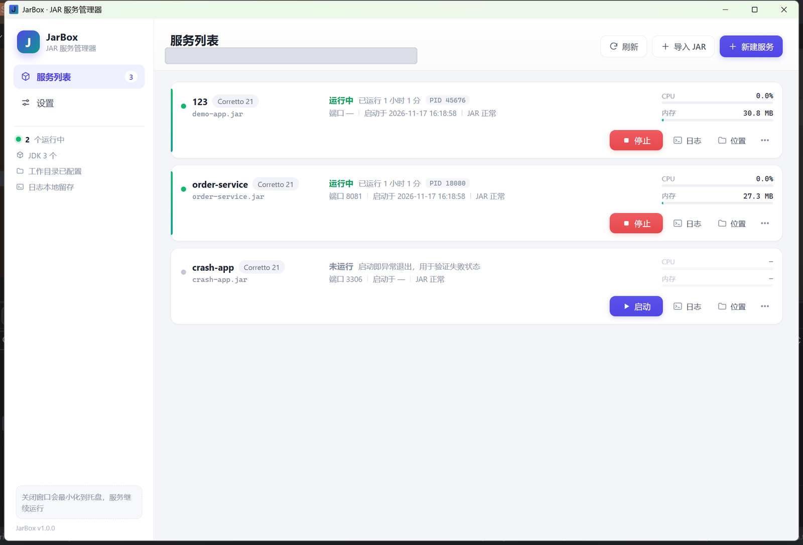
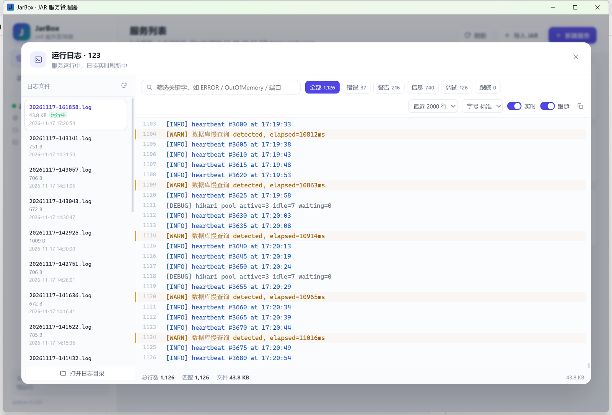
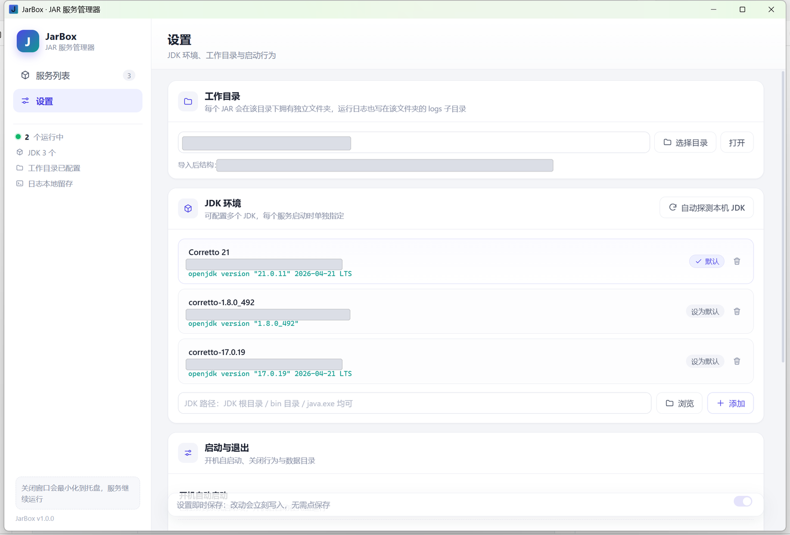

<p align="center">
  
</p>

# JarBox

一个跑在 Windows 上的本地 JAR 服务管理器。把平时散落在各个目录、靠 `java -jar` 手动启动的服务收进一个窗口：导入、启动、看日志、查端口、管 JDK，都在一起。

基于 Tauri v2（Rust）+ React 构建，发行物只有一个约 8 MB 的免安装 exe，不需要除 JRE 之外的任何额外依赖。

当前版本 `1.0.0`，是项目开源后的第一个版本，以 [MIT 许可](LICENSE)发布。



> 截图中的本机路径已做遮挡处理。

## 为什么做这个

本地开发经常要同时跑好几个 Spring Boot / 普通 JAR 服务，命令行窗口开一堆，谁在跑、端口是多少、日志在哪，全靠记。JarBox 用桌面包了一层壳，把这些事情固定下来：

- 一个 JAR 一个目录，配置跟着 JAR 走，不用记路径；
- 端口不填，启动后自己从日志里读；
- 关掉窗口不杀服务，下次打开自动接回来；
- 就算被任务管理器强杀、或者直接断电重启，下次启动照样恢复上次在跑的服务。

## 功能

| 能力 | 说明 |
| --- | --- |
| 导入 JAR | 拖拽或选择文件，按 JAR 名在工作目录下建独立目录，自动生成服务配置 |
| 多 JDK | 配置多个 JDK 路径，每个服务单独指定，启动前校验可用性 |
| 启动参数 | JVM 参数、程序参数、工作目录分别配置，参数按 shell 习惯解析（支持引号） |
| 端口识别 | 不填端口，启动后从日志尾部识别 `port 8080`、`localhost:8080`、`0.0.0.0:3000` 等写法 |
| 日志查看 | 按服务留存历史日志，支持关键字过滤、级别筛选、字号切换、鼠标选中复制 |
| 运行状态 | 运行时长、PID、内存占用、CPU 占用、是否被接管 |
| 进程接管 | 管理器退出（或被强杀）后服务仍在跑，下次启动自动认领原来的进程，不会重复起 |
| 退出恢复 | 记住上次退出时在跑的服务，下次启动按需拉起；被强杀/断电也能恢复 |
| 单实例 | 只允许一个管理器实例，再次双击会把已有窗口唤到前台，避免两个进程抢同一批服务 |
| 开机自启 | 写用户级启动项（免管理员），被安全软件拦截时给出可操作的提示 |
| 托盘运行 | 关闭按钮最小化到托盘，服务继续跑；托盘菜单可打开主界面或彻底退出 |

## 界面

### 服务列表

每行是一个服务：状态、运行时长、PID、识别到的端口、内存、CPU，右侧是停止/日志/定位/更多。



### 日志查看器

按级别统计（错误/警告/信息/调试/跟踪），支持关键字过滤、只看最近 N 行、实时刷新开关。勾选文本时会暂停轮询，方便复制。



### 设置

工作目录、JDK 环境、开机自启、退出行为、启动恢复，改动即时保存，没有「保存」按钮。

## 快速开始

### 直接使用

1. 下载 `JarBox-1.0.0-portable.exe`（或从源码构建后取 `jarbox.exe`）。
2. 双击运行 —— 免安装，可以放在任意目录，比如 `D:\jarbox\`。
3. 打开「设置」，配置工作目录和至少一个 JDK。
4. 回到服务列表，点「导入 JAR」或把 JAR 拖进窗口。
5. 点「启动」，日志和端口会自己出来。

本项目只提供便携版单文件，**不提供安装包**：没有安装向导，不写注册表卸载项，删除 exe 就是彻底卸载。配置和日志都放在 `%APPDATA%\com.jarbox.app` 与你自己指定的工作目录里，删 exe 不会丢配置。

### 从源码构建

需要 Node.js 18+、Rust 工具链（stable，MSVC target）、Windows 的 WebView2 运行时（Win10/11 自带）。

```bash
npm install
npm run app:build
```

产物：

- `src-tauri/target/release/jarbox.exe` —— 可直接运行的免安装程序，也是唯一的发行物

项目配置了 `bundle.active = false`，构建时不会生成任何安装包（NSIS 之类的安装器一律不产出），唯一的产物就是这个 exe。

开发模式（前端热更新）：

```bash
npm run app:dev
```

只跑前端：`npm run dev`；类型检查：`npm run build`（内部执行 `tsc --noEmit`）。

## 使用说明

### 工作目录与导入

导入的 JAR 会复制到 `<工作目录>/<JAR 名>/<JAR 名>.jar`，同名冲突时自动加 `-2`、`-3` 后缀。日志写在 JAR 同级的 `logs/` 目录，按启动时间命名（如 `20261117-161858.log`）。

服务配置（JAR 路径、JDK、启动参数）保存在 `%APPDATA%\com.jarbox.app\store.json`。把整个工作目录拷到另一台机器后，重新导入即可，JAR 和日志都在里面。

### 端口是怎么来的

不要求填端口。服务启动后，JarBox 读日志尾部 96 KB，从最后一行往前匹配这几种写法：

- `Tomcat started on port 8080`
- `port(s): 8080`
- `localhost:8080` / `0.0.0.0:3000` / `http://host:8080`

识别结果按「本次启动 + 日志文件」缓存，不会每 2 秒重复读盘。识别不到时显示 `—`，服务本身不受影响。

### 关闭窗口、退出与恢复

- **关闭按钮**：最小化到托盘，服务继续跑。
- **托盘 → 退出 JarBox**：按设置里的「退出时停止服务」决定是否停掉 Java 进程。
- **再次打开**：先把上次遗留、且仍在运行的 Java 进程认领回来（PID 不变），再按快照把该恢复的服务拉起来。

恢复的依据是两个文件：

- `running.json`：服务 → PID，运行中每次启动/停止/进程退出都会立即落盘；
- `last_session.json`：退出快照，记录「最后一次已知在跑的服务」。

所以被任务管理器结束、断电、蓝屏、重启电脑都不会丢状态：

| 情形 | 下次启动的表现 |
| --- | --- |
| 只结束 `JarBox.exe`（任务管理器「结束任务」） | Java 子进程不受影响，直接接管，PID 不变 |
| 结束进程树 / 断电 / 重启电脑 | Java 也没了，按失效记录自动重新拉起 |
| 运行中手动停止过某个服务 | 该服务不会被恢复（停止会同步刷新快照） |

## 数据存放位置

| 内容 | 路径 |
| --- | --- |
| 服务配置、设置 | `%APPDATA%\com.jarbox.app\store.json` |
| 运行中记录 | `%APPDATA%\com.jarbox.app\running.json` |
| 退出快照 | `%APPDATA%\com.jarbox.app\last_session.json` |
| 自动恢复日志 | `%APPDATA%\com.jarbox.app\auto_start.log` |
| 服务运行日志 | `<JAR 所在目录>\logs\` |
| 开机自启 | `HKCU\Software\Microsoft\Windows\CurrentVersion\Run` 下的 `JarBox` 项 |

## 常见问题

**Q：360 安全卫士把 exe 删了 / 报「拒绝访问 (os error 5)」**

360 的主动防御会按程序拦截注册表写入，也会直接删除它不认识的新 exe。处理方式：把 JarBox 加入信任区（木马查杀 → 信任区），被删的话先在恢复区还原；「开机自启」如果提示被拦截，加白名单后在设置里重开一次即可。

**Q：端口一直显示 `—`**

说明日志里没有可识别的端口行。常见于普通 JAR（非 Web 服务）或日志被重定向到文件之外。可以给服务加 `--server.port=8080` 之类的参数让框架把端口打出来，或直接看日志确认。

**Q：服务自己崩了会自动重启吗**

不会。崩溃退出只会标记状态并记录退出码，避免陷入崩溃-重启循环；下次手动启动或重启管理器时，若它仍在快照里才会恢复。手动停止的服务不会被恢复。

**Q：能不能同时开两个 JarBox**

不能。用命名互斥体做了单实例限制，第二次启动只会把已运行的窗口唤到前台。这样可以避免两个实例抢同一批 Java 进程和同一份配置。

**Q：为什么 Java 进程在 JarBox 退出后还在**

取决于「退出时停止服务」这个开关。默认开启，退出时会结束进程树；关掉后进程保留，下次启动自动接管。

**Q：怎么卸载**

没有安装程序，也就没有「卸载向导」。托盘图标右键 →「退出」，然后删掉 exe 就行。配置在 `%APPDATA%\com.jarbox.app`，服务与日志在你自己的工作目录里，想彻底清干净就把这两处一并删掉；如果开过「开机自启」，还需要在设置里把它关掉。

## 技术栈

- **后端**：Rust + Tauri v2，`sysinfo` 读进程信息，`winreg` 写启动项，Win32 FFI 抢前台焦点
- **前端**：React 18 + TypeScript + Vite，无 UI 框架，样式手写
- **发行**：只有一个便携版 exe，不做安装包；图标由 `scripts/gen-icon.mjs` 直接生成 PNG，无第三方依赖

## 目录结构

```
├─ src/                     前端
│  ├─ App.tsx               主界面、视图切换、确认弹窗
│  ├─ api.ts                Tauri 命令封装
│  ├─ types.ts              与后端对齐的类型
│  ├─ utils.ts              格式化与错误文案
│  ├─ styles.css            全部样式
│  └─ components/
│     ├─ ServiceRow.tsx     服务行
│     ├─ ServiceDialog.tsx  新建/编辑服务
│     ├─ LogViewer.tsx      日志查看器
│     ├─ SettingsView.tsx   设置页
│     ├─ JarInspector.tsx   查看 JAR 内配置
│     ├─ Modal.tsx          弹窗基座
│     └─ Icons.tsx          图标
├─ src-tauri/
│  ├─ src/
│  │  ├─ lib.rs             入口：插件注册、setup、托盘
│  │  ├─ commands.rs        核心逻辑：启停、配置、日志、端口、接管与恢复
│  │  ├─ model.rs           数据结构
│  │  ├─ proc.rs            Java 进程启动与结束
│  │  ├─ port.rs            日志端口识别
│  │  ├─ autostart.rs       用户级开机自启
│  │  ├─ focus.rs           窗口置前
│  │  ├─ jar.rs             读取 JAR 内配置
│  │  └─ store.rs           store.json 读写
│  ├─ icons/                应用图标
│  └─ tauri.conf.json       窗口与打包配置
├─ docs/screenshots/        README 截图
├─ scripts/gen-icon.mjs    生成图标源图
├─ testdata/                测试用 Java 源码与资源
└─ LICENSE                  MIT 许可
```

## 开发说明

- 后端单元测试：`cd src-tauri && cargo test --lib`（覆盖端口识别、参数解析、设置补丁、恢复合并等）。
- 前端类型检查：`npx tsc --noEmit`。
- 图标：`node scripts/gen-icon.mjs` 用纯数学绘制 1024×1024 源图（`src-tauri/icons/source.png`），再 `npx tauri icon src-tauri/icons/source.png -o src-tauri/icons` 导出各尺寸与 `icon.ico`。
- 修改 `src-tauri/tauri.conf.json` 的 identifier 会同时改变数据目录和单实例互斥体，已有配置不会自动带过去。

## 许可证

以 [MIT 许可](LICENSE)发布，版权归 2026 7rikka 所有。可以自由使用、修改、分发，包括商业用途，保留版权声明即可。
